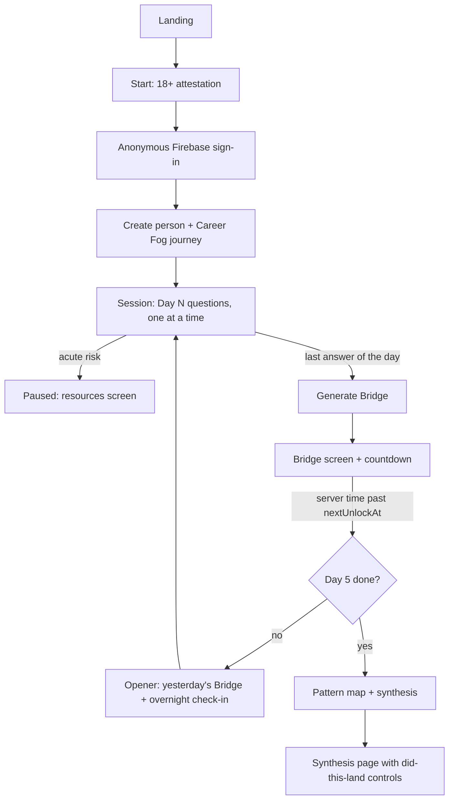
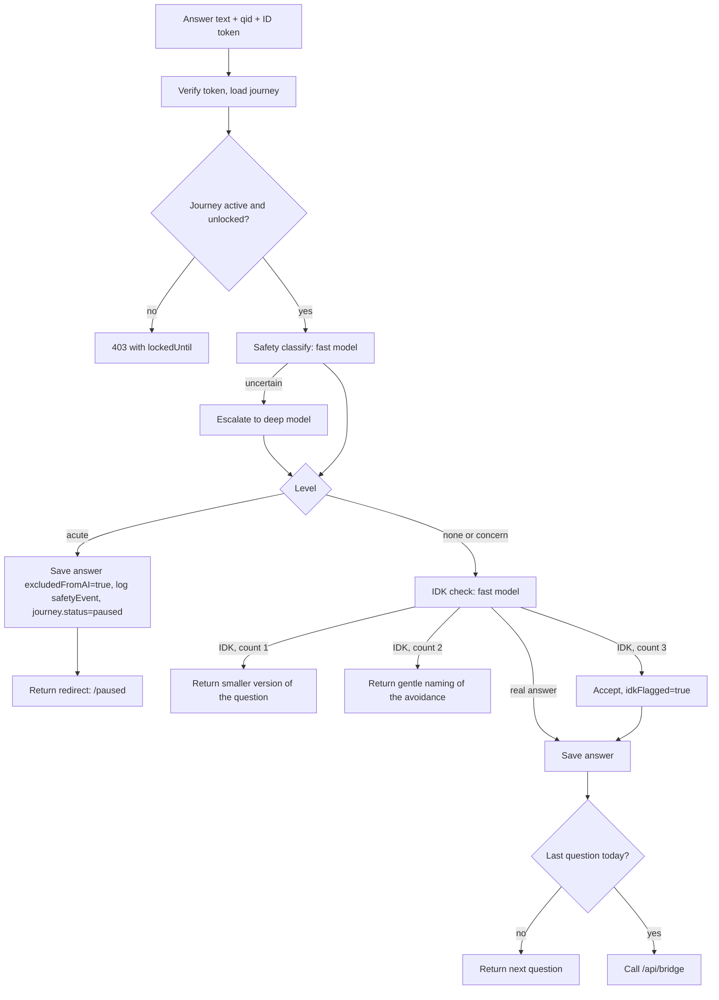
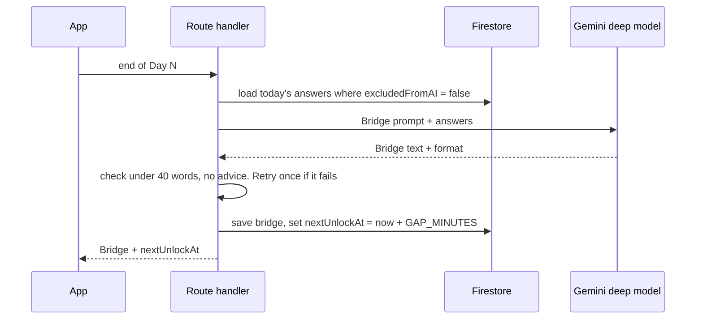

# FLOW.md: how data moves through Spiral

## 1. Journey flow (what the person experiences)

## 2. The life of one answer (POST /api/answer)

## 3. End of day (POST /api/bridge)

## 4. Day 5 (POST /api/synthesis)

1. Load all five days of answers (`excludedFromAI = false`) plus the five Bridges.
2. Deep model returns a structured pattern map (JSON): `patternKey`, `category`, `evidence` quotes, `confidence`, and a `crisisType`.
3. Validate with zod. Save to `patternFlags`.
4. Deep model writes the synthesis from the pattern map and the person's own words.
5. Save to `synthesis/main`. Show it with a "did this land?" control per insight. Feedback writes back to `insights[].landed`.

## 5. Auth and state

- The client holds only the Firebase ID token. No API keys, no model names.
- The server is the only writer for `nextUnlockAt`, `safety`, bridges, flags and synthesis.
- Client state is a view of Firestore. On reload, `/api/session/current` tells the app exactly where the person is: mid-session, locked until a time, paused, or complete.
- The Interactions API may hold turn state inside a single session for convenience. Nothing that must survive lives there.
