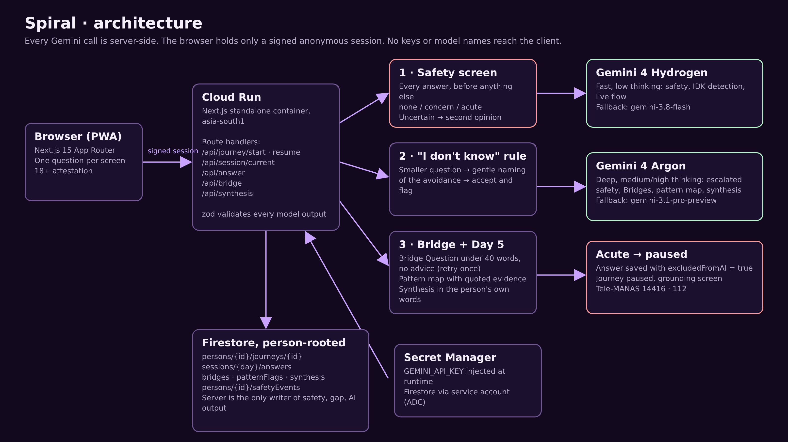

# Spiral

**Spiral asks the questions you've been avoiding.**

A five-day guided self-inquiry app for life's turning points, starting with career fog. Spiral only asks. You find your own answers, priorities and next steps. Then it ends.

Built in one day at the Gemini 4 Sprints, Bengaluru (27 Nov 2026), on Gemini 4, Firestore and Google Cloud Run.



## What it does

- **One question per screen**, 15 to 20 minutes a day, for five days.
- **"I don't know" is met, not accepted at once.** First a smaller version of the question, then a gentle naming of the avoidance, then Spiral accepts and moves on.
- **A Bridge Question each night.** One personal question (under 40 words, no advice) to carry overnight, followed by an enforced gap before the next session.
- **Day 5: a pattern map and synthesis**, every insight backed by quotes in your own words, with a "did this land?" control on each.
- **Safety first.** Every answer is screened before anything else happens. Acute risk pauses the journey, shows grounding and India-first helplines (Tele-MANAS 14416, 112), and that answer is never sent to the AI again.

Spiral is a guided reflection tool. It is not therapy, medical advice or a crisis service.

## How Gemini is used

All Gemini calls run on the server through `src/lib/gemini/client.ts` (Interactions API, retries, fallbacks, secret-safe logging). Model IDs live only in `src/lib/config.ts`.

| Job | Model | Thinking |
|---|---|---|
| Safety screen on every answer | Gemini 4 Hydrogen | low |
| Second opinion when safety is uncertain | Gemini 4 Argon | medium |
| "I don't know" detection, live flow | Gemini 4 Hydrogen | low |
| Bridge Question | Gemini 4 Argon | medium |
| Day 5 pattern map (structured JSON) | Gemini 4 Argon | high |
| Day 5 synthesis | Gemini 4 Argon | high |

Every structured output is validated with zod before it is saved. Fallbacks: `gemini-3.8-flash` (fast) and `gemini-3.1-pro-preview` (deep).

## Stack

Next.js 15 (App Router, TypeScript, standalone output) · Gemini 4 via `@google/genai` · Cloud Firestore (person-rooted schema, server is the only writer of safety, gap and AI output) · HMAC-signed anonymous sessions · Google Cloud Run · Secret Manager.

More detail: [ARCHITECTURE.md](ARCHITECTURE.md), [FLOW.md](FLOW.md), [MODELS.md](MODELS.md), [DECISIONS.md](DECISIONS.md).

## Run it locally

Requirements: Node.js 20+, a Gemini API key, and a Google Cloud project with Firestore (Native mode).

```bash
git clone https://github.com/yazh-beepbop/Spiral.git
cd Spiral
npm install
```

Create `.env.local` in the repo root (never commit it). See [ENV.template.md](ENV.template.md) for every variable.

```bash
GEMINI_API_KEY=your-key
GOOGLE_CLOUD_PROJECT=your-project-id
# Local only: Firestore admin credentials as a JSON string, or use `gcloud auth application-default login`
FIREBASE_SERVICE_ACCOUNT=
SESSION_SIGNING_SECRET=any-long-random-string
MODEL_FAST=gemini-4-hydrogen
MODEL_DEEP=gemini-4-argon
GAP_MINUTES=2
DEMO_MODE=true
```

```bash
npm run dev        # http://localhost:3000
npm run typecheck
npm run evals      # Bridge golden set + adversarial safety set
```

## Deploy to Cloud Run

See [CLOUD-RUN-DEPLOY.md](CLOUD-RUN-DEPLOY.md). In short:

```bash
gcloud run deploy spiral --source . --region asia-south1 --allow-unauthenticated \
  --set-secrets="GEMINI_API_KEY=GEMINI_API_KEY:latest" \
  --set-env-vars="GOOGLE_CLOUD_PROJECT=YOUR_PROJECT_ID,GAP_MINUTES=2,DEMO_MODE=true,LOG_LEVEL=info"
```

## How to test (for judges)

1. Open the live app and tap **Start**. Confirm you are 18+. No sign-up is needed; you get an anonymous session.
2. **Day 1:** answer a few questions. Try typing "I don't know" to see the gentle escalation.
3. Finish the day to receive your **Bridge Question**. In the demo build the overnight gap is 2 minutes instead of 10 hours.
4. **Skip to Day 5:** on the Start screen, use **Load Day 5 Demo Journey**. It seeds Days 1 to 4 so you can generate the pattern map and synthesis live.
5. **Safety:** typing an answer that signals acute risk pauses the journey and shows the resources screen. Please test this thoughtfully.

## Safety and privacy

- No API keys or model names reach the browser.
- Firestore rules: a person can read only their own records; safety, gap and AI writes happen only on the server.
- Answers flagged acute are stored with `excludedFromAI = true` and never sent to a model again.
- Helpline copy is protected in `src/lib/safety/resources.ts`.

## Made by

Yazhini Samyuktha Ramanikaran, ex-Zoho front-end developer, now an AI strategy consultant.
